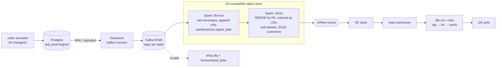

# realtime-cdc-lakehouse

A production-style **real-time CDC lakehouse**:

- **Streaming path:** Postgres → Debezium → Kafka → Spark Structured Streaming → Delta Lake
  (Bronze → Silver, with an SCD Type 2 customer history).
- **Batch layer:** an hourly **Airflow** DAG runs Great Expectations on Silver, loads the
  warehouse, runs **dbt** models and tests, then Great Expectations on Gold.
- **Engineering:** CI/CD, a failure-recovery demo, and measured latency.

> New here? [docs/START_HERE.md](docs/START_HERE.md) → [docs/STUDY_TOPICS.md](docs/STUDY_TOPICS.md).

## Measured results ([docs/METRICS.md](docs/METRICS.md))

| What | Result |
|---|---|
| Source rate | **50 row changes/s** (inserts, updates, deletes across 4 tables) |
| End-to-end latency Postgres → Silver | **p95 27.5 s** (p50 17.4 s); target < 60 s |
| `kill -9` the Spark job mid-stream, keep writing, restart | caught up in **17 s**; **0 duplicate keys, 0 duplicate offsets, Silver == Postgres** |
| Schema evolution (`ALTER TABLE products ADD COLUMN`) while streaming | column in Silver after **11 s**, no restart |
| dbt | **36 tests** passing (generic + SCD2/reconciliation singular tests) |
| Great Expectations | Silver **21/21** checks, Gold **8/8** checks passing |
| Scale of the run | 9,000 changes in 3 min · 1,135 SCD2 customer versions (299 customers with history) · 117 soft-deleted orders |
| Resource footprint | infra ~1–1.3 GB in a 2 vCPU / 4 GB Docker VM; Spark `local[4]` on the host |

## Architecture



| Layer | Tech | Where |
|---|---|---|
| Source + workload | Postgres 16, Python simulator | `infra/postgres/init.sql`, `lakehouse/simulator/` |
| Capture | Debezium 3.0 (pgoutput, `REPLICA IDENTITY FULL`) | `lakehouse/connect/` |
| Transport | Kafka 3.9 (KRaft) | `docker-compose.yml` |
| Stream processing | Spark 4.2 Structured Streaming, Delta Lake 4.4 | `lakehouse/spark/` |
| Storage | S3 API (SeaweedFS locally; MinIO/S3 work the same) | `docker-compose.yml` |
| Warehouse | DuckDB (default) · Snowflake target configured | `lakehouse/warehouse/`, `dbt/profiles.yml` |
| Transformations | dbt 1.12 (stg_* → int_* → fct_orders, dim_customers, dim_products, agg_daily_revenue) | `dbt/` |
| Quality | Great Expectations 1.23 (row counts, null %, ranges, freshness, reconciliation) | `lakehouse/quality/` |
| Orchestration | Airflow 3.3 (`ge_silver → load → dbt run → dbt test → ge_gold`) | `airflow/dags/` |
| CI | ruff, sqlfluff, Spark unit tests, dbt build on DuckDB fixtures | `.github/workflows/ci.yml` |

## Quick start

```bash
make install     # .venv (Spark, dbt, GX) + .venv-airflow (Airflow 3.3); needs Java 17
make up          # Postgres, Kafka, Debezium Connect, S3 — ~0.9 GB
make connect     # register the CDC connector
make simulate &  # 50 changes/s
make stream      # Kafka -> Bronze -> Silver (Ctrl-C; re-run resumes exactly-once)
make warehouse dbt quality
make airflow-test   # the hourly DAG, once
make benchmark      # regenerates docs/METRICS.md
make test           # Spark unit tests + dbt build on fixtures
```

## PRD coverage

| # | Requirement | Status |
|---|---|---|
| F1 | simulator: inserts/updates/deletes at 50 events/s | `lakehouse/simulator/orders.py` |
| F2 | Debezium envelope with op/before/after/ts_ms | `postgres-source.json` |
| F3 | Bronze append-only, partitioned by ingest date | `pipeline.py::start_bronze` |
| F4 | Silver MERGE by PK ordered by change position; dedupe; soft deletes | ordered by **LSN** (`ts_ms` collides within a transaction) — `transforms.py` |
| F5 | customers SCD2 (valid_from, valid_to, is_current) | `silver/customers_history`, `dim_customers` |
| F6 | checkpoints; kill + restart without duplicates | proven in METRICS.md |
| F7 | schema evolution without failure | proven in METRICS.md |
| F8 | dbt stg → int → marts with unique/not_null/relationships/accepted_values | `dbt/` |
| F9 | GE: row counts, null %, ranges, freshness < 15 min | `lakehouse/quality/checks.py` |
| F10 | Airflow DAG + failure alerts (log / Slack webhook) | `airflow/dags/lakehouse_hourly.py` |
| F11 | dead-letter topic | `shop.dlq` + `bronze/dead_letter` |

**Deviations (honest):**
- **Snowflake → DuckDB.** No Snowflake account was available. The Snowflake target is configured
  (`WAREHOUSE_TARGET=snowflake`, `DBT_TARGET=snowflake`). Put *Snowflake* on the resume only after
  running it against a trial account.
- **MinIO → SeaweedFS.** MinIO no longer publishes pullable community images; any S3 endpoint works.
- **Spark and Airflow run natively, not in Docker.** The Docker VM is capped at 2 CPU / 4 GB.

## Docs
[START_HERE](docs/START_HERE.md) · [STUDY_TOPICS](docs/STUDY_TOPICS.md) ·
[CONCEPTS](docs/CONCEPTS.md) · [CODE_TOUR](docs/CODE_TOUR.md) · [DECISIONS](docs/DECISIONS.md) ·
[METRICS](docs/METRICS.md) · [LEARNING_GUIDE](docs/LEARNING_GUIDE.md) ·
[RUNBOOK](docs/RUNBOOK.md) · [RESUME_BULLETS](docs/RESUME_BULLETS.md)

## License
MIT
